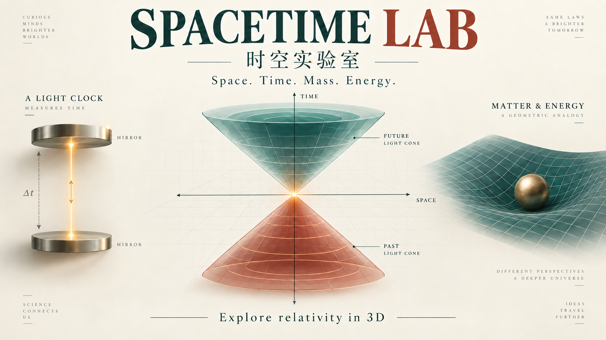
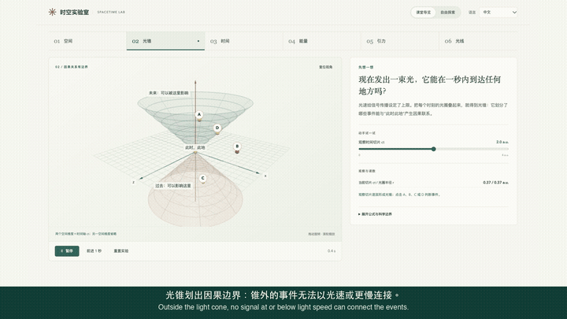
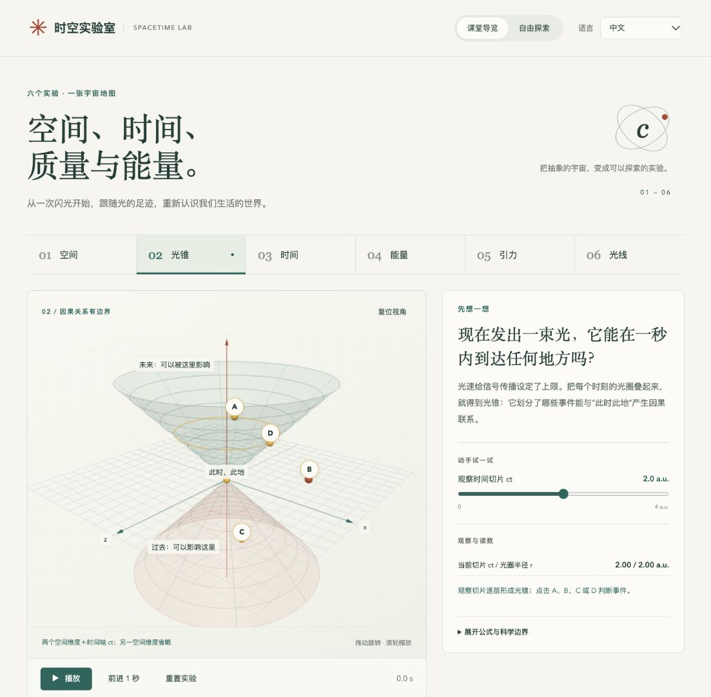

<p align="center">
  
</p>

<h1 align="center">时空实验室 · Spacetime Lab</h1>
<p align="center"><strong>改变一个变量，看见一个规律。</strong><br>面向高中生与好奇者的六个相对论 3D 互动实验</p>
<p align="center">中文 · <a href="README.en.md">English</a> · <a href="media/video/spacetime-lab-demo.mp4">观看 64 秒演示</a> · <a href="#快速开始">本地运行</a></p>

---

时间为什么会“变慢”？光没有静止质量，为什么还会偏折？

在这里，你可以转动光锥、调节光钟的速度、比较能量柱图，再观察光线经过天体时的偏折。每个实验从一个日常问题开始，把**看见变化 → 比较读数 → 理解公式**连起来。

## 先看它如何工作

[](media/video/spacetime-lab-demo.mp4)

**[完整 MP4 演示](media/video/spacetime-lab-demo.mp4)** · 1080p / 64 秒 / 中英文字幕 / 无旁白  
[可单独下载的双语字幕](media/subtitles/spacetime-lab-demo.zh-en.srt)

动图和视频来自实际运行的网页；封面由 ChatGPT 图像生成工具制作，是概念插图。视频使用适合录屏的简化布局，完整网页还包含练习与科学来源。GitHub 中如不能直接播放 MP4，可打开文件页下载播放。



## 六个实验，一条学习路线

| 实验 | 动手做什么 | 带走什么 |
| --- | --- | --- |
| 01 空间与事件 | 改变位置，记录时刻 | 描述事件需要位置和时间 |
| 02 光锥与因果 | 点击事件，比较因果区域 | 光速限制了信号可以到达的范围 |
| 03 光钟与时间 | 调节速度，切换观察参考系 | 同一运动钟在不同参考系中的时间比较 |
| 04 质量与能量 | 改变质量与速度 | 静止能量、总能量与动能的关系 |
| 05 时空曲率 | 改变示意曲面的凹陷 | 用二维类比建立几何直觉 |
| 06 光线偏折 | 改变天体质量与掠过距离 | 比较弱场近似给出的偏折角 |

试试光钟：速度设为 **0.8c**，暂停、重置、前进 10 次。地面读数是 **10 秒**，运动钟读数是 **6 秒**。

## 为课堂和自学设计

- **中文 / English / 中英对照**切换，保留当前实验状态。
- 鼠标或触控转动 3D 场景；播放、暂停、单步观察、复位镜头。
- 公式与模型边界按需展开，三道练习提供即时反馈。
- 响应式布局；支持减少动态效果的系统偏好。
- 无 WebGL 2 时保留文字、静态示意、数值计算和练习。
- 无账号、无后端、无 API key；构建后依赖与公式字体本地打包。语言偏好只保存到浏览器本地。

## 快速开始

需要 Node.js **22.12+**。克隆仓库后，在项目目录运行：

```sh
npm ci
npm run dev
```

打开终端显示的本地网址。生产构建与检查：

```sh
npm test
npm run build
npm run preview -- --port 4173
```

使用 HTTP 服务访问，不能直接双击源码 HTML。课堂投影可在网址后加 `?presentation=1`；录屏布局再加 `&capture=1`。项目提供源码与本地演示，尚未提供托管的在线体验。

## 科学准确性与模型边界

这是概念教学工具，尚未开展真实高中生学习效果评估。

- 光锥展示两个空间维度与时间轴，采用归一化单位；过去光锥不表示时间倒流。
- 光钟比较匀速惯性参考系；不模拟加速、重逢或完整的双生子问题。循环轨迹是视觉示意，累计时间读数保持连续。
- 质量采用不变质量；静止能量为 `E₀ = mc²`，总能量为 `E = γmc²`。
- 凹陷网格是任意指定的二维类比，不是四维时空的外形，不求解爱因斯坦场方程。
- 光偏折读数采用球对称弱场公式 `α ≈ 4GM/(bc²)`；画面角度放大 **8,000 倍**，过渡光路为插值示意，不是求解零测地线。
- 无 WebGL 的降级路径已实现，本次验收未在实际无 WebGL 设备上验证。

教学解释参考 [Einstein Online：光钟与时间膨胀](https://www.einstein-online.info/en/spotlight/light-clocks-time-dilation/)、[时空](https://www.einstein-online.info/en/spacetime/)、[光线与等效原理](https://www.einstein-online.info/en/spotlight/equivalence_light/)、[NIST：质能关系的实验检验](https://www.nist.gov/news-events/news/2005/12/einstein-was-right-again-experiments-confirm-e-mc2)与 [Stanford Gravity Probe B](https://einstein.stanford.edu/SPACETIME/spacetime3.html)。这些来源未为本项目背书。

## 技术与项目结构

**Three.js** 构建程序化 3D 场景，**KaTeX** 排版公式，**Vite** 打包静态网页。

| 文件 | 职责 |
| --- | --- |
| `src/physics.js` | 独立计算、常数与弱场近似 |
| `src/content.js` | 成对双语教学文案、参数与来源 |
| `src/scene.js` | 3D 场景、标签与镜头 |
| `src/main.js` | 交互状态、语言切换、读数与练习 |
| `tests/physics.test.js` | 已知数值、物理比例与双语内容检查 |
| `media/` | 概念封面、实际录屏、截图与字幕 |

计算与渲染分离，六个场景复用一个渲染器和控制器。[验收记录](VALIDATION.md) · [素材来源与制作说明](media/PROVENANCE.md)

如果它帮助你看懂了一个概念，欢迎点亮 Star；也欢迎通过 Issue 分享教学中遇到的疑问、翻译建议或模型改进。
